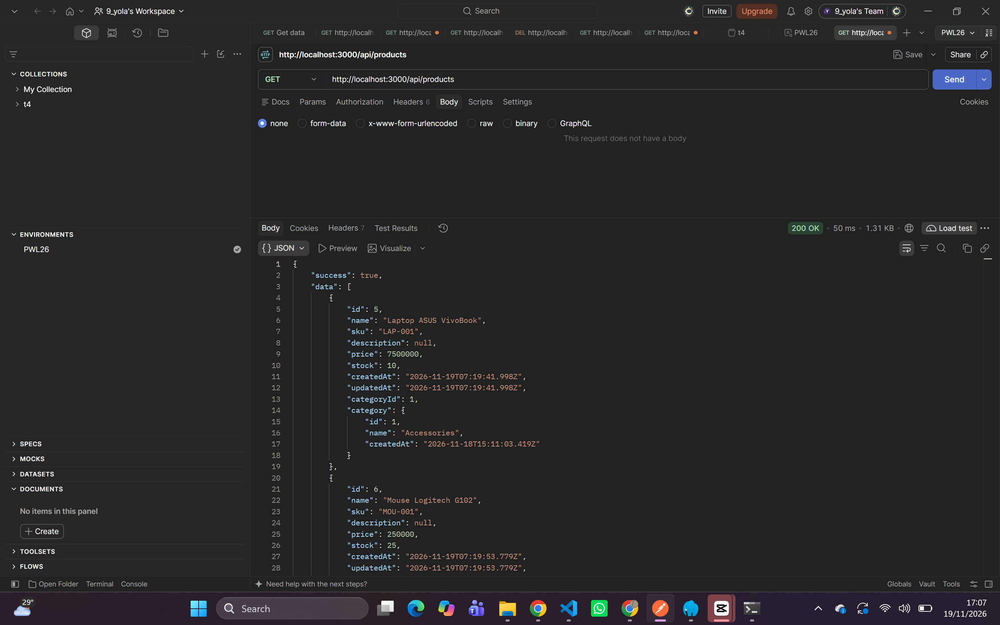
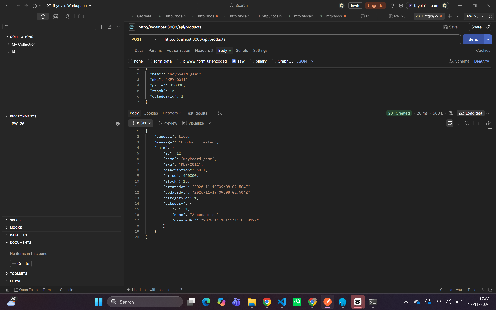
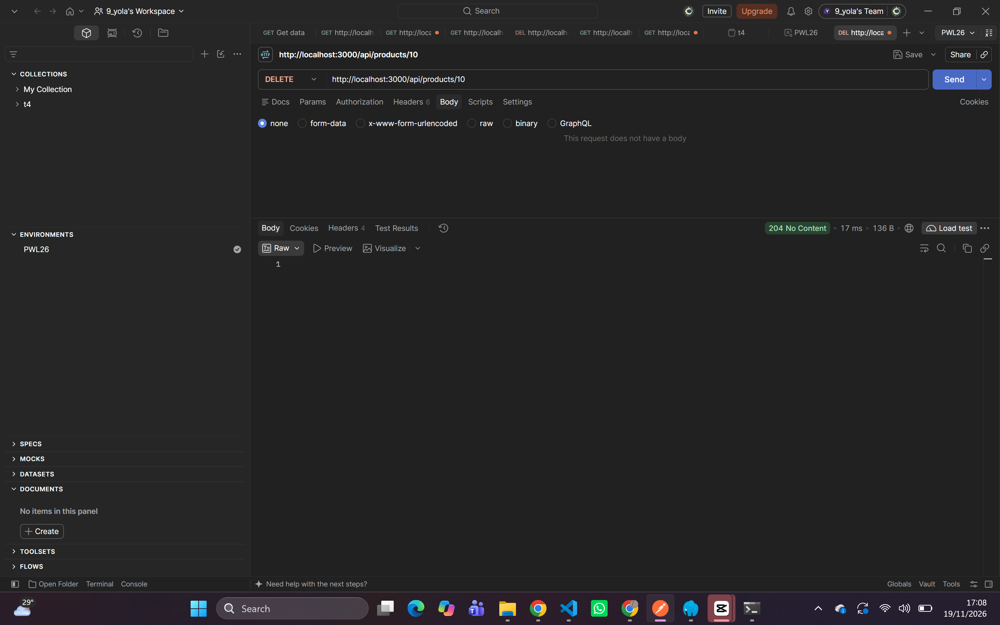
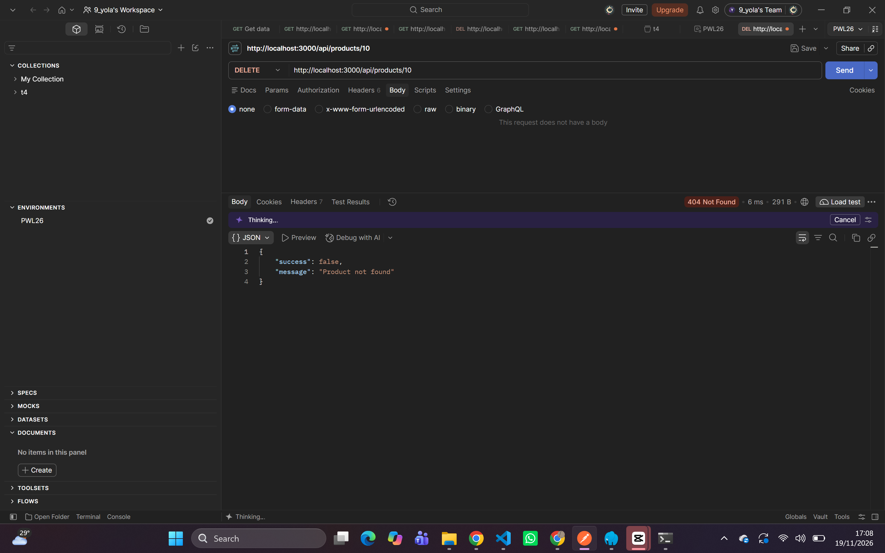
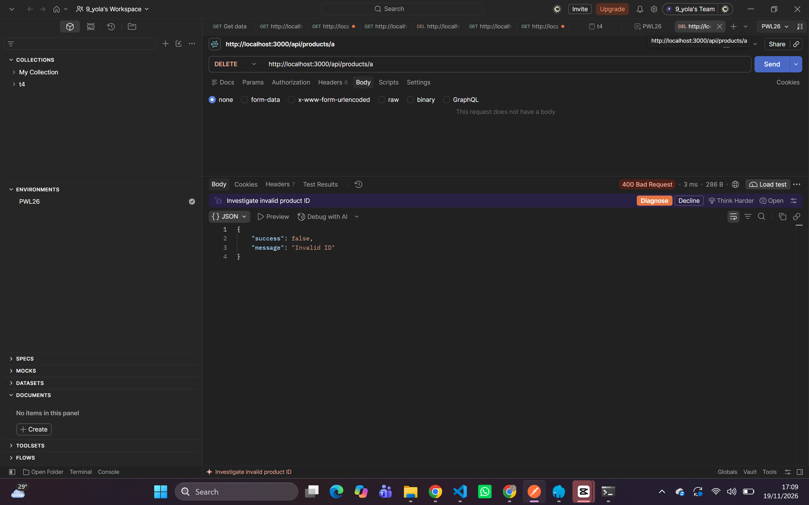
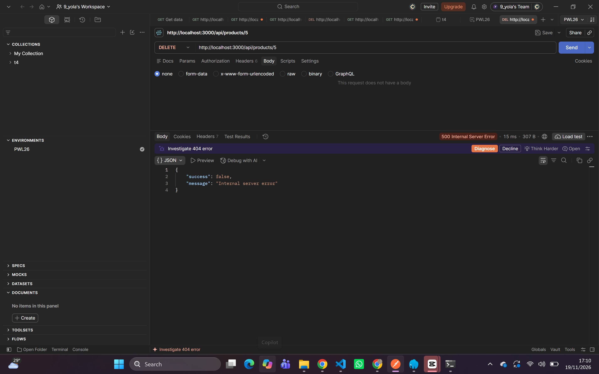

# Stockify API

## Identitas

- **Nama:** Baiq Erwina Yolanda
- **NIM:** F1D02410039
- **Mata Kuliah:** PWL
- **Project:** Stockify API
- **LINK YOUTUBE:** ....


## Deskripsi

Stockify API merupakan backend API untuk mengelola data produk, meliputi pengambilan data, penambahan produk, dan penghapusan produk. Project ini menggunakan Node.js, Express, TypeScript, Prisma, dan MySQL.

## Teknologi

- Node.js
- Express.js
- TypeScript
- Prisma ORM
- MySQL

## Cara Menjalankan Project

1. Clone atau download repository.
2. Install dependencies:

   ```bash
   npm install
   ```

3. Konfigurasi database pada file `.env`.
4. Jalankan migration Prisma:

   ```bash
   npx prisma migrate dev
   ```

5. Jalankan server:

   ```bash
   npm run dev
   ```

6. API dapat diakses melalui:

   ```text
   http://localhost:3000
   ```

## Endpoint API

Base URL:

```text
http://localhost:3000/api/products
```

| Method | Endpoint | Fungsi |
|---|---|---|
| GET | `/api/products` | Menampilkan daftar produk |
| POST | `/api/products` | Menambahkan produk |
| DELETE | `/api/products/:id` | Menghapus produk berdasarkan ID |

## Pengujian API

Pengujian dilakukan menggunakan Postman dengan beberapa skenario:

| Pengujian | Endpoint | Expected Status |
|---|---|---|
| Menampilkan produk | GET `/api/products` | 200 |
| Menambahkan produk | POST `/api/products` | 201 |
| Delete berhasil | DELETE `/api/products/:id` | 204 |
| Product tidak ditemukan | DELETE `/api/products/:id` | 404 |
| ID tidak valid | DELETE `/api/products/abc` | 400 |
| Simulasi error internal | DELETE `/api/products/:id` | 500 |

## Screenshot Pengujian

### 1. GET Products

Menampilkan daftar produk dari database.



### 2. POST Product

Pengujian penambahan produk baru.



### 3. DELETE Berhasil

Pengujian penghapusan produk dengan response 204 No Content.



### 4. Error 404

Pengujian penghapusan produk yang tidak ditemukan.



### 5. Error 400

Pengujian ID yang tidak valid.



### 6. Error 500

Pengujian simulasi internal server error melalui errorHandler.



## Deklarasi Penggunaan AI

Dalam project ini, saya menggunakan AI sebagai bantuan untuk memahami konsep, mencari solusi ketika mengalami error, dan memperoleh referensi. Proses pengerjaan dan pengujian tetap saya lakukan sendiri.

## Kesimpulan

Project ini membantu saya memahami proses pengembangan API, penggunaan routing, controller, service, database, serta penerapan validasi dan error handling. Saya juga mendapatkan pengalaman dalam melakukan pengujian API menggunakan Postman dan memperbaiki kesalahan selama proses pengembangan.
